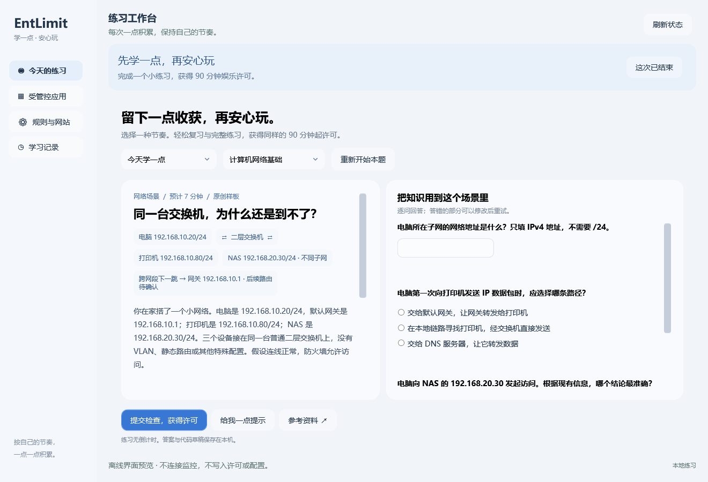
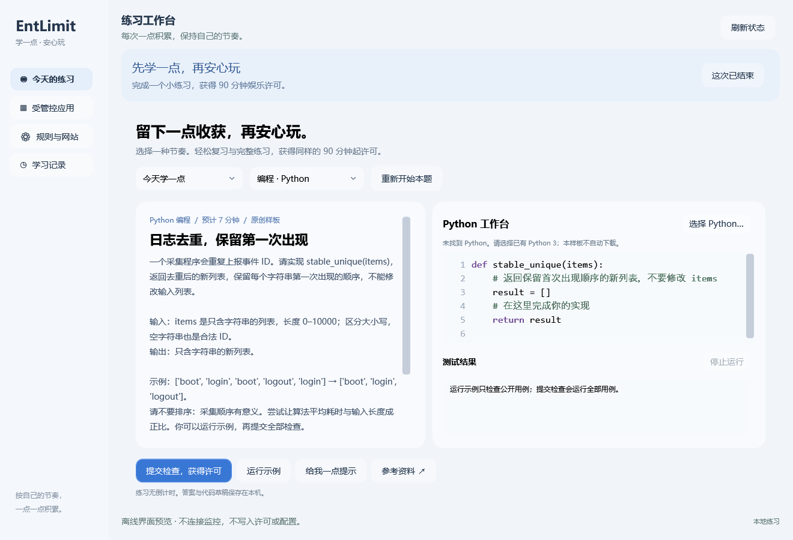
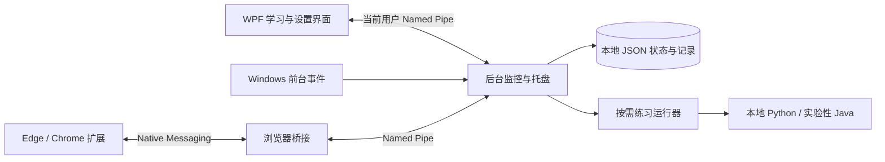

<div align="center">

# EntLimit

**学一点，安心玩。**

完成一次小练习，留下一点知识积累，再享受属于自己的娱乐时间。


[功能](#功能) · [安装与使用](#安装与使用) · [实现原理](#实现原理) · [扩展计划](#扩展计划) · [从源码构建](#从源码构建)

</div>

## 项目介绍

EntLimit 是 Windows 上的学习与娱乐陪伴工具。选择希望管理的游戏、应用或网站，完成网络基础练习，或实际写一道 Python 题，获得至少 **90 分钟**的共享娱乐许可。

正常练习和轻松复习获得相同的时长；答错时提供提示，完成后记录收获。许可到期时提醒你寻找合适的收尾时机，允许已登记的进程继续运行，退出后重新锁定。

当前为可运行原型，题库规模、浏览器兼容性与长期使用体验仍在完善。应用采用合作式窗口软管控，适合个人自我管理；家长防绕过模式尚未实现。

## 界面预览

| 网络场景练习 | Python 编程工作台 |
| :---: | :---: |
|  |  |

预览来自应用自身的离线布局，不包含真实桌面背景和原生标题栏。实际窗口使用 Windows 最小化、最大化和关闭按钮；系统支持时使用 Acrylic 材质，透明效果受系统设置影响。

## 功能

| 功能 | 当前支持 |
| --- | --- |
| 应用发现 | 手动扫描安装信息、Steam 库及可见窗口，过滤常见系统和辅助进程，支持搜索与手动添加 EXE |
| 学习解锁 | 完成整组知识题或通过全部代码检查，获得至少 90 分钟共享许可 |
| 网络知识 | 场景描述、知识材料、多问填空与选择、逐题反馈和提示 |
| Python 练习 | 本地编辑、运行示例、提交用例、输出反馈、参考解法与复杂度说明 |
| 解答分析 | 默认本地 Python AST 规则分析，可主动调用自己配置的模型服务获取建议 |
| 学习记录 | 标记已通过题，正常模式优先新题，轻松模式优先复习；复习时不预填旧答案 |
| 选题方式 | 记住默认题集，支持推荐与候选池内随机 |
| 提醒与收尾 | 声音、托盘及可选不激活浮层；到期不抢焦点、不结束游戏 |
| 自用辅助 | 可选登录自启、轻量守护、调试停用入口与独立紧急关闭程序 |
| 题包导入 | 导出 AI 提示词和 JSON 范本，预览去重并确认导入，可添加其他知识方向 |
| 浏览器桥接 | 提供 Edge / Chrome 扩展源码，需手动安装、注册和授权，兼容性仍在验证 |

当前内置题库为原创样板：两组网络场景、两道 Python 编程题及对应复习题。题量仍少，尚未接入 LeetCode 每日一题，也没有自动抓取课程或网上题库。

## 安装与使用

### 安装

1. 打开本仓库右侧 **Releases**，下载 `EntLimit-Setup-0.3.1-win-x64.exe`。源码 ZIP 不包含可安装程序。
2. 可将文件的 SHA256 与同版本 `.sha256` 文件比较。
3. 运行安装器并同意 Windows 管理员授权。普通学习界面、监控和练习运行器仍以当前用户权限运行。
4. 从开始菜单打开 **EntLimit**。

支持 Windows 10 / 11 x64，安装器最低系统版本为 Windows 10 1809。应用自带 .NET 运行库。Python 练习需要自行安装 Python 3.8+，网络知识题无需 Python；程序不会自动下载解释器或 JDK。

安装包目前未签名，Windows 可能显示未知发布者。安装器不自动添加管控目标、不自动注册自启，也不安装浏览器扩展。

### 获得一次娱乐许可

1. 在“受管控应用”中扫描或手动添加目标，确认实际 EXE 路径。
2. 在“今天的练习”选择题集和正常/轻松模式。
3. 完成知识题或通过代码用例后获得许可；第一次使用受管控目标开始连续计时。
4. 关闭学习窗口后监控留在托盘。到期会提醒收尾，已登记进程退出后重新锁定；也可手动结束本次娱乐。

多个目标共享同一次许可；休眠、离开电脑仍会计时，继续做题不会叠加已有时长。没有许可时，受管控前台窗口会被最小化，学习入口最大化置顶。获得许可或暂停管控后取消置顶。

### 暂停与紧急关闭

规则页的“调试入口”可关闭管控、自启和守护，或停用后退出。界面卡死时，从开始菜单运行 **Emergency Stop - EntLimit**，或运行安装目录中的 **`EntLimit.EmergencyStop.exe`**。

紧急工具独立于监控通信，保存持续停用标记后关闭本安装的 EntLimit 进程。再次启动仍保持暂停，需主动恢复；学习记录保留。处理高权限残留进程可能需要明确同意 UAC，不绕过 Windows 权限检查。详见 [安装与恢复](docs/DISTRIBUTION.md)。

### 可选 API 与题包

在“API 与扩展”中填写兼容 Chat Completions 的服务地址、模型和密钥。密钥使用当前 Windows 用户的 DPAPI 加密并限制文件访问权限；远程地址要求 HTTPS。只有主动点击连接测试、在线分析或生成题包时才调用服务，相关费用由所选服务计收。

没有 API 也能完成内置题、离线判题和本地分析。在线分析会发送当前题目与代码；生成题包是待审核的模型草稿，不代表已经联网检索或验证来源。也可导出提示词，与自己的 AI 对话后导入 JSON；导入前预览答案、用例和去重结果。

详见 [在线配置](docs/ONLINE.md)、[题包格式与导入](docs/CONTENT-PACKS.md)、[代码分析](docs/CODE-ANALYSIS.md)。

## 实现原理



- **按需界面与执行**：主窗口关闭后保留后台监控；扫描由用户触发，练习进程按需启动。
- **窗口软管控**：通过 `SetWinEventHook` 接收前台切换，辅以低频检查，以 PID、创建时间、完整路径及有效父子进程证据匹配目标。无许可时最小化目标窗口；进程本身可能已经启动，不提供系统级启动拦截。
- **共享许可状态机**：`Locked → Ready → Active → Draining`，分别表示待学习、许可准备、连续计时和允许现有进程收尾。Monitor 负责核心状态、题包和学习记录的持久化；界面另存本机草稿、偏好和可选 API 配置。
- **本地判题**：独立进程执行函数及用例，设置时间、内存与输出限制；完整通过后由 Monitor 保存记录并兑现许可。运行示例、查看答案和代码分析均不发奖。
- **数据位置**：安装版保存到 `%LOCALAPPDATA%\EntLimit\data`；便携构建使用自身的 `data` 目录。核心 JSON 使用原子替换与备份恢复。

Python / Java 运行器用于可信的个人练习，具有当前用户的文件和网络权限，资源限制不构成恶意代码安全沙箱。独立管理员辅助仅最小化已配置的高权限目标窗口，不执行练习代码或终止游戏。

## 扩展计划

希望未来通过插件扩展 Java、C++ 等编程练习，以及语文、英语等知识内容。

- **内容题包已经可用**：填空、选择和场景练习通过 JSON 题包扩充，附少量可选示例；不需要运行插件代码。
- **运行器接口已预留并有实验实现**：代码包含独立进程 JSON 协议、显式信任登记与文件哈希校验，以及实验性 Java 桥接；Java 需自行配置 JDK。
- **尚未完成**：面向普通用户的第三方插件管理界面、插件市场、自动安装更新和 C++ 运行器。当前不宣称已有完整插件生态。

开发接口见 [插件协议](docs/PLUGINS.md)。后续还计划补充题库来源管理、工作日/周末/休假规则，以及浏览器和全屏多屏兼容性验证。家长模式另行设计。

## 从源码构建

需要 Windows、.NET 10 SDK。生成安装包还需 Inno Setup 6+；运行 Python 或 Java 练习分别需要已有的解释器或 JDK。

```powershell
# 构建、验证并生成可运行程序
./scripts/build.ps1

# 生成 Windows 安装 EXE 和 SHA256
./scripts/package.ps1
```

也可以双击 `BuildInstaller.cmd`。SDK 或 Inno 不在默认位置时，可传 `-DotnetPath`、`-IsccPath`；构建脚本使用本机环境，不需要开发者的 API 配置。详细参数见 [发布说明](docs/DISTRIBUTION.md)。成功打包默认清理临时发布目录，`-KeepStaging` 可保留用于诊断。

```text
src/                  许可、监控、WPF、运行器、在线配置与恢复工具
tests/                状态机、判题、IPC、插件及恢复测试
browser-extension/    Edge / Chrome 扩展与安装说明
scripts/              构建、打包与调试入口
installer/            Inno Setup 安装配置
docs/                 使用、数据格式与扩展协议
```

安装器输出到 `artifacts/installer/`。EXE 作为 GitHub Release 附件分发，不提交进源码历史。仓库不包含个人运行配置、API 密钥、学习记录、草稿、SDK 或旧开发缓存。

## 已知限制与内容说明

- 收尾依据是进程退出，尚不能通用识别“一局结束”；常驻启动器可能需要手动结束许可。
- 独占全屏、多显示器、不同权限窗口及浏览器扩展的完整端到端兼容性仍需验证；初次锁定时最小化可能影响部分游戏。
- 自用守护可被拥有本机权限的用户绕过，不提供防卸载或家长安全边界。
- 题目和模型生成内容需要人工审核；参考链接不代表复制了原站题目，也不保证有限用例覆盖所有输入。
- 本项目尚未指定开源许可证；公开源码不代表已授予任意再分发许可。第三方运行组件适用各自附带的许可。
